# Qwen Comic for ComfyUI

Make complete comic pages in ComfyUI from **one style image + a cast list + a script**. It runs locally and uses only free, open-source models (Qwen-Image-Edit-2511 and Qwen3.5, both Apache 2.0).

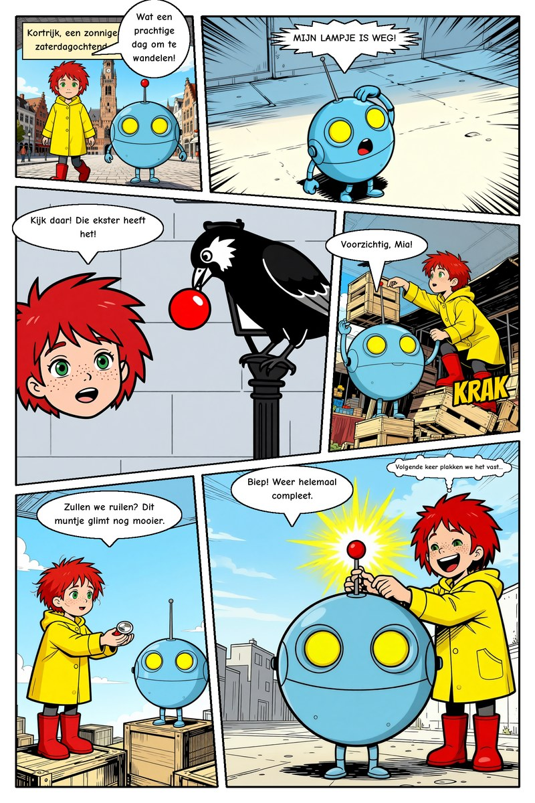

*The example above was made on an RTX 4070 Laptop (8 GB VRAM) in about 18 minutes, with the included example workflow. The only manual step was moving one balloon with `adjust`.*

**What it does**

- Draws every panel in the style of your reference image.
- Keeps characters identical from panel to panel, using a character sheet that is drawn automatically.
- Checks every panel with a vision model. Duplicate characters, strangers or a wrong item are removed automatically, or the panel is redrawn.
- Adds crisp, correctly spelled balloons in empty space next to the right speaker. You can move any balloon by hand.
- Optional: a local AI writes the script from a short story.

---

## Contents

0. [Quick install on a server (ComfyUI-Manager)](#0-quick-install-on-a-server-comfyui-manager)
1. [Install](#1-install)
2. [Downloads and where to put them](#2-downloads-and-where-to-put-them)
3. [The workflow at a glance](#3-the-workflow-at-a-glance)
4. [Input 1: cast and script](#4-input-1-cast-and-script)
5. [Input 2: style reference and page layout](#5-input-2-style-reference-and-page-layout)
6. [Run, and what you get](#6-run-and-what-you-get)
7. [Other functions](#7-other-functions)
8. [Tips, speed and known limits](#8-tips-speed-and-known-limits)

---

## 0. Quick install on a server (ComfyUI-Manager)

Use this when ComfyUI runs on a remote or shared server that you can only reach through the web page.

1. **Install the node.** In ComfyUI open **Manager → Custom Nodes Manager → Install via Git URL** and paste:
   ```
   https://github.com/Nick-HITLab/ComfyUI-QwenComic
   ```
   When it's done, restart ComfyUI with the Manager's **Restart** button, then **reload the page**.
2. **Download the models onto the server.** Open **Templates** (left side bar) → *Custom nodes* → **ComfyUI-QwenComic** → **0 - Download models**.
   - Click **Run** with `really_download` OFF. The report shows what is already on the server and what is missing.
   - If files are missing, turn `really_download` ON and click **Run** again. That's about 35 GB for the server set, downloaded straight from Hugging Face.
   - When it finishes, press **R** to refresh the model lists.
3. **Open the comic workflow.** Go to **Templates → ComfyUI-QwenComic → Comic - server (fp8, 24GB+)**, or **Comic example NL - server (fp8)** for the filled-in Dutch example. Then click **Run**.

**Speed on a big GPU** (24 GB VRAM or more): every model stays in video memory, so a 6-panel page with the vision check takes a few minutes instead of the 15–20 minutes on an 8 GB laptop. On a shared server, other people's jobs in the queue come first.

**Your own style image on a server:** in the STYLE REFERENCE node, click *choose file to upload*. Two example styles are already installed (`comic_style_reference.png`, `comic_style_pastel.png`).

## 1. Install

You need:

- **ComfyUI 0.36 or newer.** This was tested with ComfyUI Desktop 0.37.2. Older versions miss the *Generate Text* node and Qwen3.5 support.
- **An NVIDIA GPU with 8 GB VRAM or more**, and at least 32 GB of system RAM.

Steps:

1. **Install the custom node.** Either copy the folder `ComfyUI-QwenComic` into `ComfyUI/custom_nodes/`, or run `git clone https://github.com/Nick-HITLab/ComfyUI-QwenComic` inside `ComfyUI/custom_nodes/`, or use ComfyUI-Manager → *Install via Git URL*.
2. **Only for the GGUF workflow** (8–16 GB VRAM), install **ComfyUI-GGUF**. In ComfyUI-Manager, search for *ComfyUI-GGUF* and click *Install*, or run `git clone https://github.com/city96/ComfyUI-GGUF` inside `ComfyUI/custom_nodes/`.
3. **Download the models** from the table in section 2 and put each file in its folder. You can also let ComfyUI do it with the template **0 - Download models** (see section 0).
4. **Restart ComfyUI.** The example images (style references and so on) are copied into `ComfyUI/input/` automatically on the first start.
5. **Open a workflow.** They are in ComfyUI under **Templates → ComfyUI-QwenComic**. They are also in the folder `example_workflows/`, so you can drag one onto the ComfyUI window:

   | Workflow | When to use |
   |---|---|
   | `Comic - laptop (GGUF, 8-16GB)` | **8–16 GB VRAM**. Empty template in English. |
   | `Comic example NL - laptop (GGUF)` | Same, already filled in with the Dutch example story from the image above. |
   | `Comic - server (fp8, 24GB+)` | **24 GB VRAM or more** (fp8 model, no GGUF needed). |
   | `Comic example NL - server (fp8)` | The Dutch example for 24 GB+. |
   | `0 - Download models` | Checks which models are missing and downloads them into the right folders. |

**6.** After downloading new models, press **R** in ComfyUI to refresh the model lists. Check that every loader in group 1 shows the right file, then click **Run**.

## 2. Downloads and where to put them

The table uses `ComfyUI/models/` for the models folder:

- **Portable or manual install:** this is the `models` folder inside your ComfyUI folder.
- **ComfyUI Desktop:** this is the models folder you chose during installation, for example `C:\Users\<you>\Documents\ComfyUI\models`. On the test PC it was `...\AppData\Local\Comfy-Desktop\ComfyUI-Shared\models`.

| # | File (click to download) | Put it in | Size | Needed for |
|---|---|---|---|---|
| 1a | [qwen-image-edit-2511-Q4_K_M.gguf](https://huggingface.co/unsloth/Qwen-Image-Edit-2511-GGUF/resolve/main/qwen-image-edit-2511-Q4_K_M.gguf) | `ComfyUI/models/unet/` | 13.2 GB | the image model, **GGUF workflow** (8–16 GB VRAM) |
| 1b | [qwen_image_edit_2511_fp8mixed.safetensors](https://huggingface.co/Comfy-Org/Qwen-Image-Edit_ComfyUI/resolve/main/split_files/diffusion_models/qwen_image_edit_2511_fp8mixed.safetensors) | `ComfyUI/models/diffusion_models/` | 20.5 GB | the image model, **normal workflow** (24 GB+ VRAM). You need 1a **or** 1b. |
| 2 | [qwen_2.5_vl_7b_fp8_scaled.safetensors](https://huggingface.co/Comfy-Org/Qwen-Image_ComfyUI/resolve/main/split_files/text_encoders/qwen_2.5_vl_7b_fp8_scaled.safetensors) | `ComfyUI/models/text_encoders/` | 9.4 GB | text encoder of the image model (always) |
| 3 | [qwen_image_vae.safetensors](https://huggingface.co/Comfy-Org/Qwen-Image_ComfyUI/resolve/main/split_files/vae/qwen_image_vae.safetensors) | `ComfyUI/models/vae/` | 0.3 GB | VAE (always) |
| 4 | [Qwen-Image-Edit-2511-Lightning-4steps-V1.0-bf16.safetensors](https://huggingface.co/lightx2v/Qwen-Image-Edit-2511-Lightning/resolve/main/Qwen-Image-Edit-2511-Lightning-4steps-V1.0-bf16.safetensors) | `ComfyUI/models/loras/` | 0.8 GB | **fast mode** (4 steps instead of 40) |
| 5 | [qwen3.5_2b_bf16.safetensors](https://huggingface.co/Comfy-Org/Qwen3.5/resolve/main/text_encoders/qwen3.5_2b_bf16.safetensors) | `ComfyUI/models/text_encoders/` | 4.5 GB | **vision check and auto-fix**, story writer |
| 6 | *optional:* [qwen3.5_4b_bf16.safetensors](https://huggingface.co/Comfy-Org/Qwen3.5/resolve/main/text_encoders/qwen3.5_4b_bf16.safetensors) | `ComfyUI/models/text_encoders/` | 9.3 GB | a more accurate (but slower) vision check and story writer |

**Custom nodes** go in `ComfyUI/custom_nodes/`:

| Folder | Where to get it | Needed for |
|---|---|---|
| `ComfyUI-QwenComic` | this repository: [github.com/Nick-HITLab/ComfyUI-QwenComic](https://github.com/Nick-HITLab/ComfyUI-QwenComic) | everything |
| `ComfyUI-GGUF` | [github.com/city96/ComfyUI-GGUF](https://github.com/city96/ComfyUI-GGUF), or ComfyUI-Manager | the GGUF workflow |

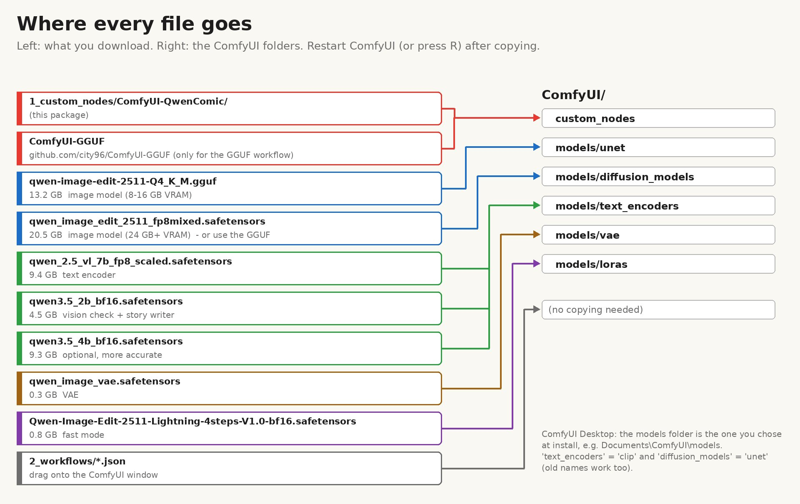

**Notes**

- `models/text_encoders` and `models/clip` are the same thing (older name), and so are `models/diffusion_models` and `models/unet`. Either folder works.
- The fonts (Comic Neue, Bangers; SIL Open Font License) are included in `ComfyUI-QwenComic/fonts/`. To use more fonts, put extra `.ttf` files there.
- The same links are in the **DOWNLOADS & INSTALL** note inside the workflow:

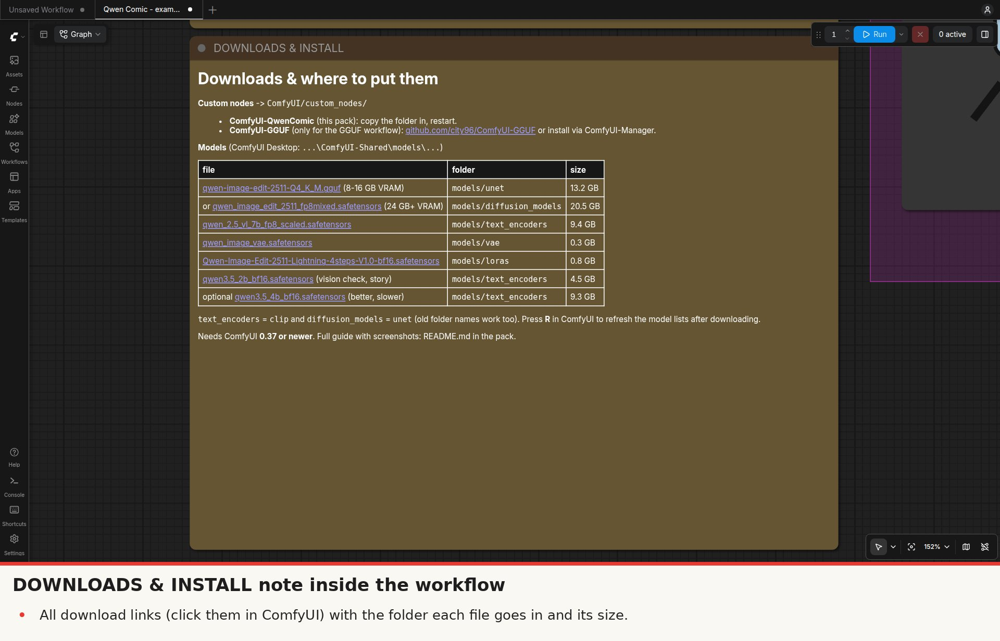

## 3. The workflow at a glance

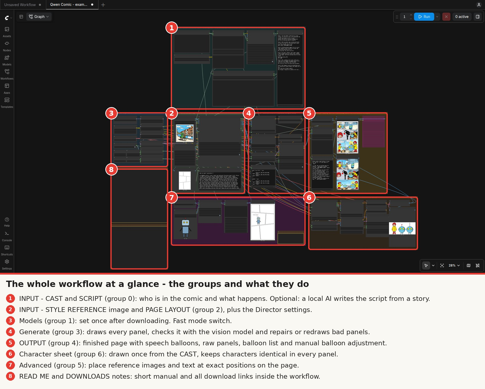

**What happens when you click Run:**

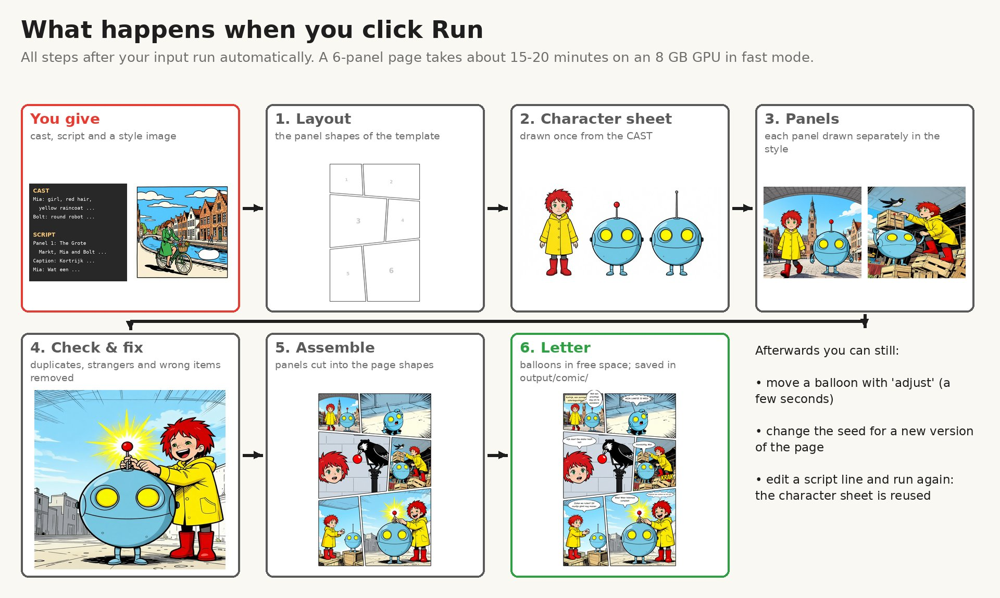

**You only fill in groups 0 and 2.** Group 1 is set once after downloading. Everything else runs by itself; groups 5 and 6 are optional extras.

The **READ ME** note inside the workflow is a short version of this guide:

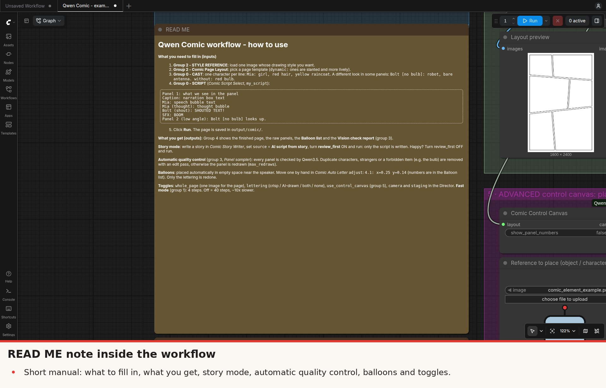

## 4. Input 1: cast and script

**Where:** group 0, at the top of the workflow.

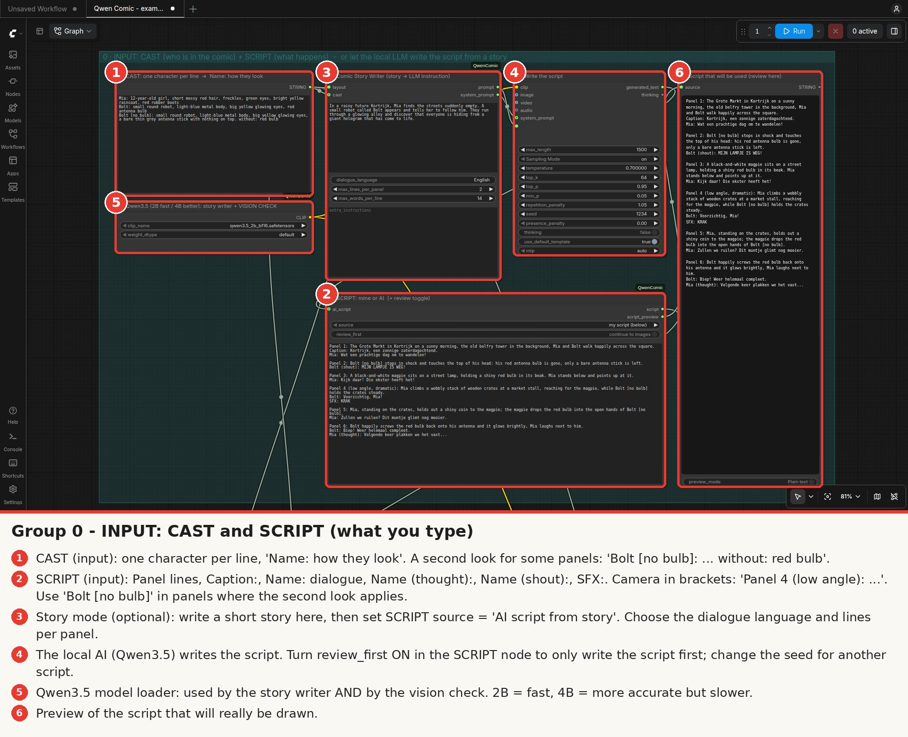

### The CAST: who is in the comic

Write one character per line as `Name: how they look`. Describe hair, clothes, colours and body type, and keep it short:

```
Mia: 12-year-old girl, short messy red hair, freckles, green eyes, bright yellow raincoat, red rubber boots
Bolt: small round robot, light-blue metal body, big yellow glowing eyes, red antenna bulb
```

- **Aliases:** `Bolt / the robot: ...`. The character is then also recognised when the script says "the robot".
- **Character versions:** add a line with the new look in square brackets for when a character looks different in some panels, for example when they lose something or get wet:
  ```
  Bolt [no bulb]: small round robot, light-blue metal body, big yellow eyes, a bare grey antenna stick. without: red bulb
  ```
  Write the full look, not just the change. `without:` names what must **not** be visible, and the vision check removes it if it shows up anyway.

What the CAST does with these lines:

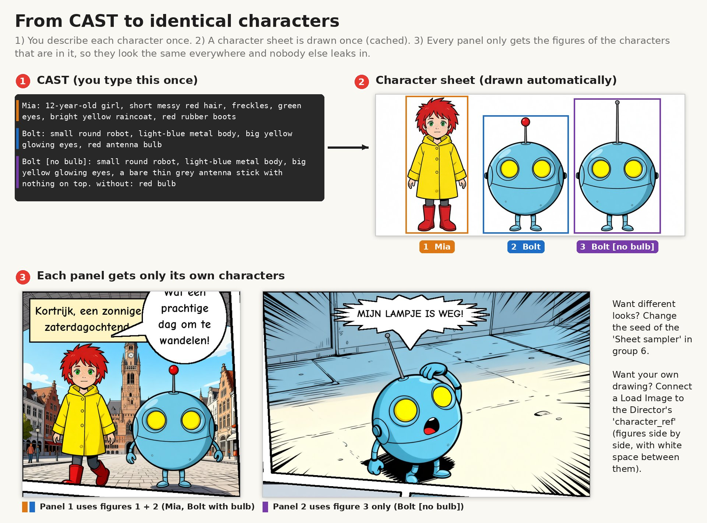

### The SCRIPT: what happens

Set `source` to **my script (below)** and type the script:

| You write | What it becomes |
|---|---|
| `Panel 1: The market square on a sunny morning.` | a new panel and what is drawn in it |
| `Panel 4 (low angle, dramatic): ...` | the panel with your own camera direction |
| `Camera: bird's-eye view` | a camera direction for the current panel |
| `Caption: Kortrijk, a sunny Saturday.` | a narration box |
| `Mia: What a beautiful day!` | a speech balloon |
| `Mia (thought): Something is wrong...` | a thought balloon |
| `Bolt (shout): MY BULB IS GONE!` | a shout balloon (spiky) |
| `SFX: CRACK` | a big sound effect |
| `Bolt [no bulb] looks up.` | Bolt is drawn in his "no bulb" version in this panel |

If you leave out the `Panel N:` lines, each paragraph becomes one panel. Characters from the CAST who aren't mentioned in a panel are kept out of that panel.

How each script line ends up on the page:

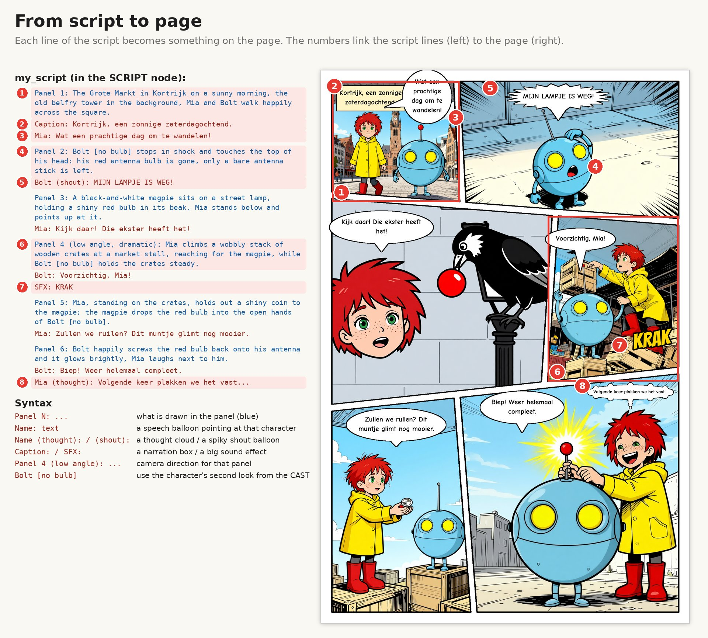

### Or let the AI write the script (story mode)

1. Write a short story in **Comic Story Writer**. You can set the dialogue language, the lines per panel, the words per line and extra wishes such as "funny tone".
2. In the **SCRIPT** node, set `source` to **AI script from story** and turn **review_first** ON. Click Run: only the script is written, and it appears in the *Script that will be used* preview.
3. If you like it, turn **review_first** OFF and click Run. The page is drawn from that script, which is cached and not rewritten. Change the seed in *Write the script* to get a different script.

## 5. Input 2: style reference and page layout

**Where:** group 2.

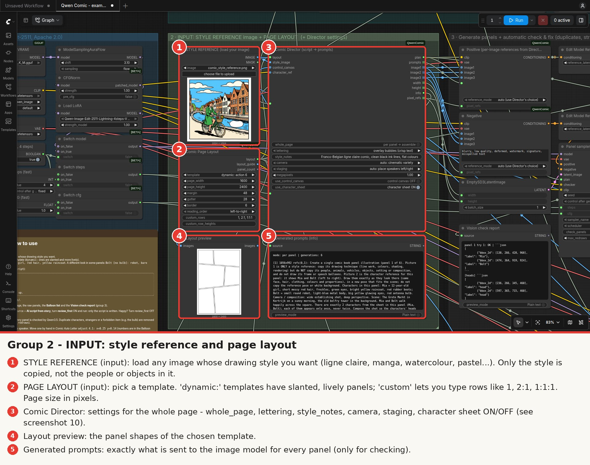

- **STYLE REFERENCE:** click *choose file to upload* and pick any picture in the style you want: ligne claire, manga, watercolour, pastel and so on. Only the drawing style is copied, not its people, objects or composition. Two examples are included in ``example_inputs/``.
- **Comic Page Layout:** choose a `template`:
  - **Classic:** 1 panel (splash), 2 or 3 rows, 2 columns, 2x2, 2x3 or 3x3 grid, classic 1-2-1, 2-1-2, big top + 2 bottom, 2 top + big bottom, big left + 2 right, uneven 5, strip 3 in a row, strip 4 in a row.
  - **Dynamic:** slanted 1-2-1, zigzag 5, action 6, diagonal duo, tall hero + 3, bleed top + 3 slanted, bleed splash + 2 insets.
  - **custom:** type the rows in `custom_rows`. For example, `1, 2:1, 1:1:1` gives one wide panel, then two panels at a 2:1 width ratio, then three equal panels.
  - `page_width` and `page_height` set the page size in pixels. `reading_order` can be switched to right-to-left for manga.

**What the style reference changes:**

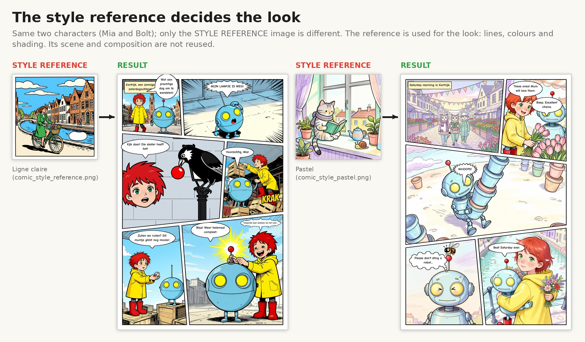

**All layout templates:**

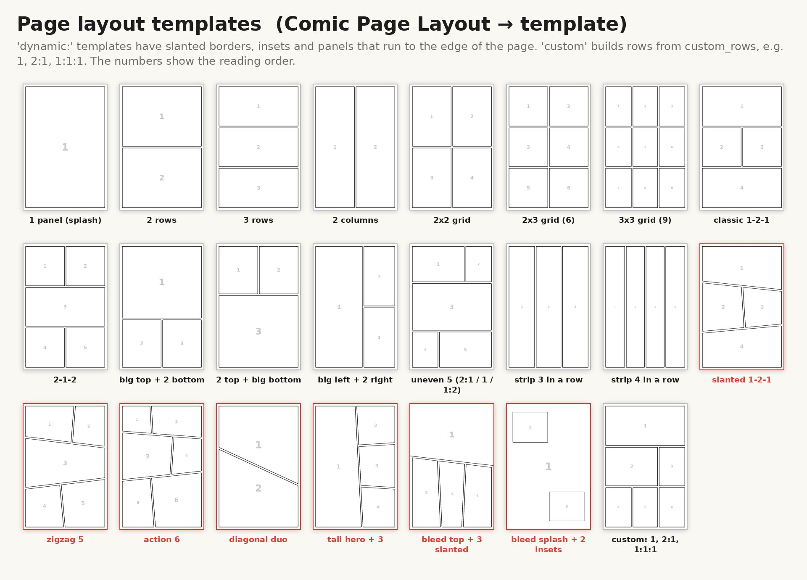

### Director settings

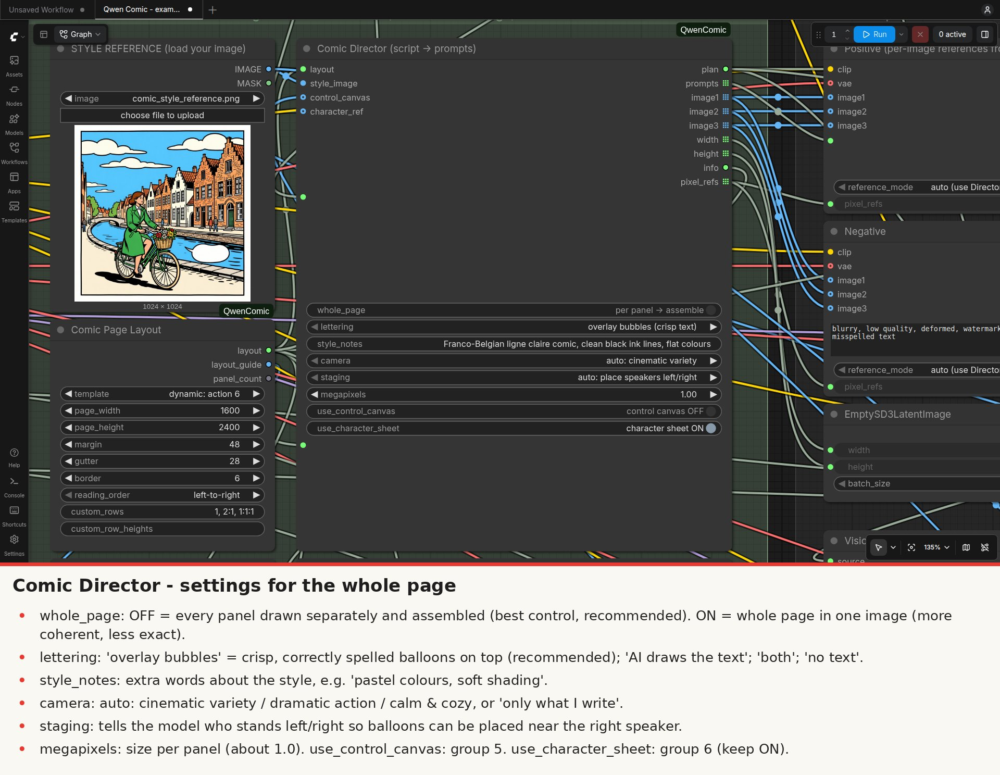

## 6. Run, and what you get

Click **Run** (top right). The finished page appears in group 4 and is saved in `ComfyUI/output/comic/`.

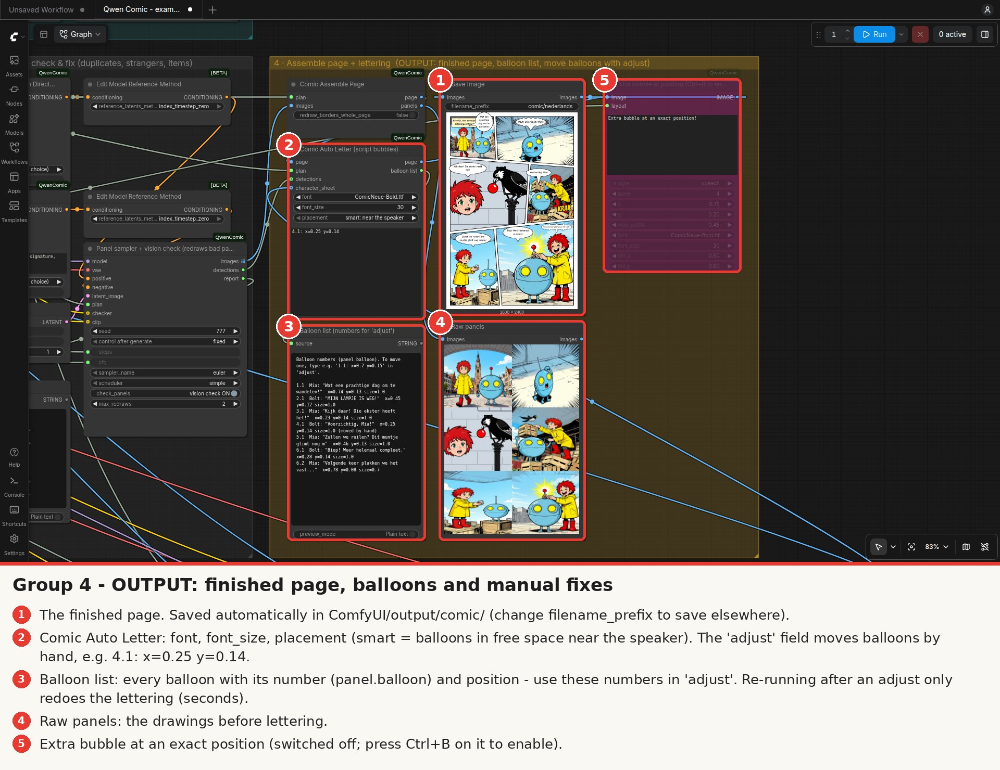

**While it runs**, group 3 draws every panel and checks it:

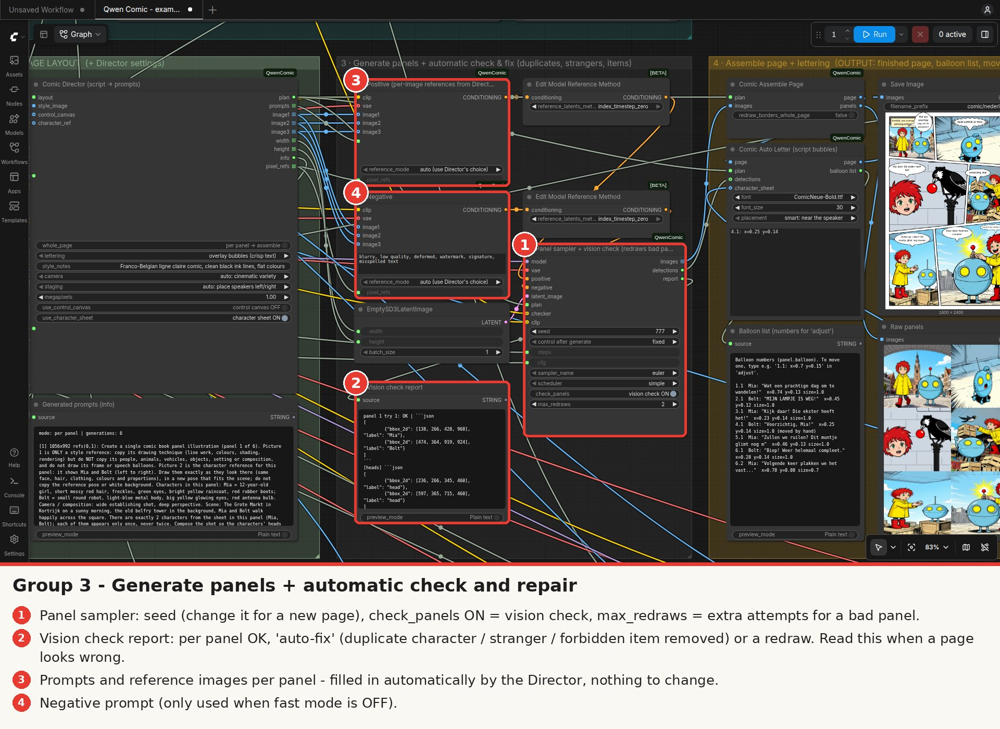

The **Vision check report** shows what happened to each panel:

| Message | Meaning |
|---|---|
| `OK` | the right characters, each exactly once |
| `Mia x2` → `auto-fix (remove the second girl on the left ...)` | a duplicate was found and removed with an edit pass |
| `1 unknown person` → `auto-fix` | a stranger was removed |
| `Bolt still has red bulb` → `auto-fix` | a forbidden item (from `without:`) was removed |
| `no free space for the balloons` | the panel is too full for its balloons, so it is redrawn |
| `try 2`, `try 3` | the panel was redrawn with a new seed (up to `max_redraws`) |

**What the check and repair look like:**

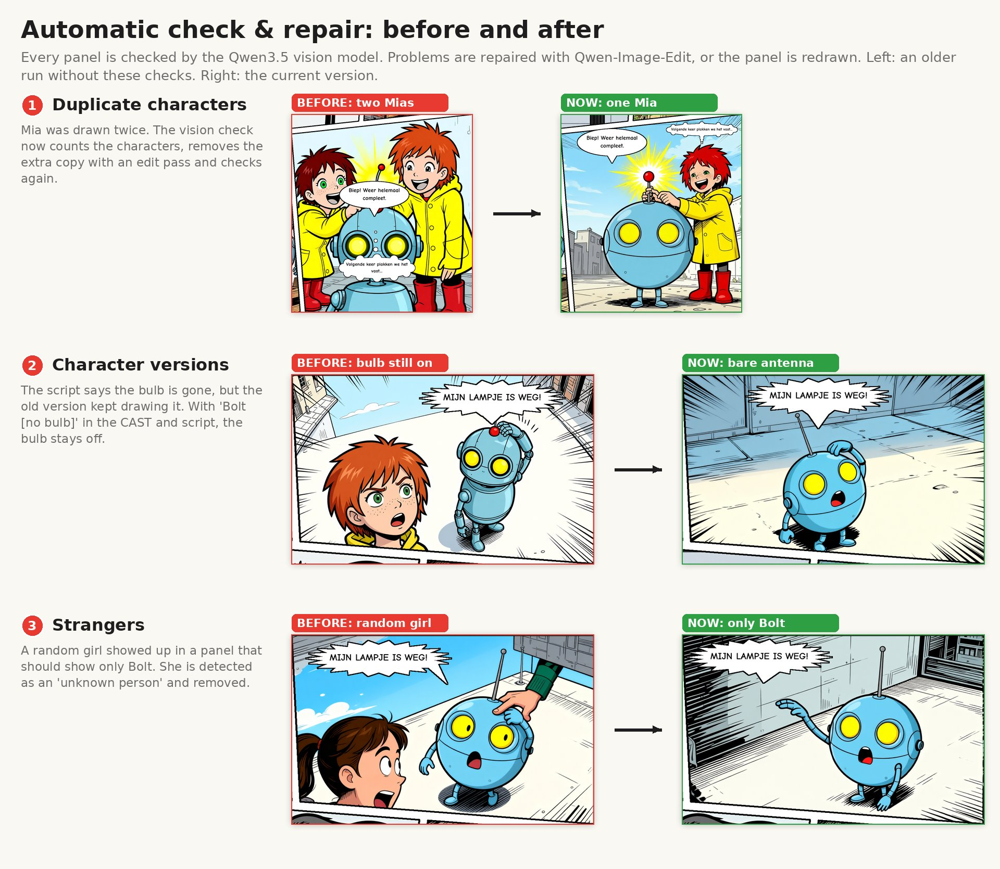

## 7. Other functions

### Move a balloon by hand

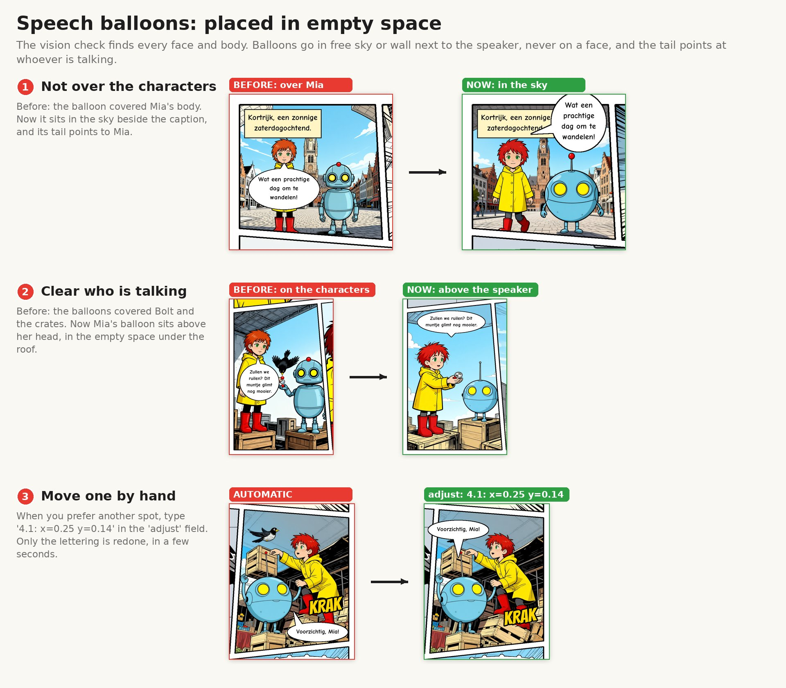

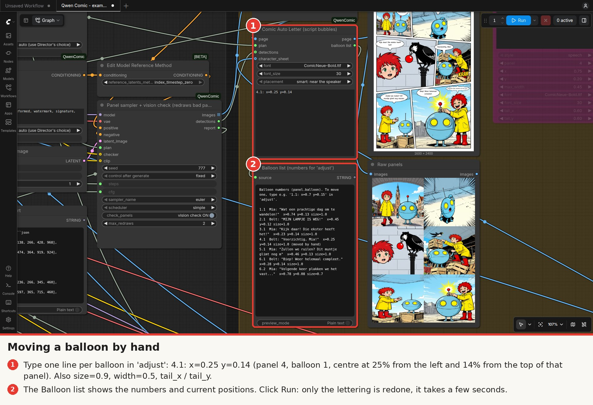

The **Balloon list** numbers every balloon as `panel.balloon`. Type a line in the `adjust` field of *Comic Auto Letter* and click Run. Only the lettering is redone, which takes a few seconds:

```
4.1: x=0.25 y=0.14     move balloon 1 of panel 4 (x, y = centre, 0..1 inside the panel)
6.2: size=0.9          make the text of balloon 2 in panel 6 smaller
3.1: tail_x=0.2 tail_y=0.6    point the tail somewhere else
```

You can also set `width=0.5` to wrap the text narrower or wider. To add a balloon that isn't in the script, select the **Extra bubble** node in group 4 and press **Ctrl+B** to enable it.

### Character sheet: consistent characters

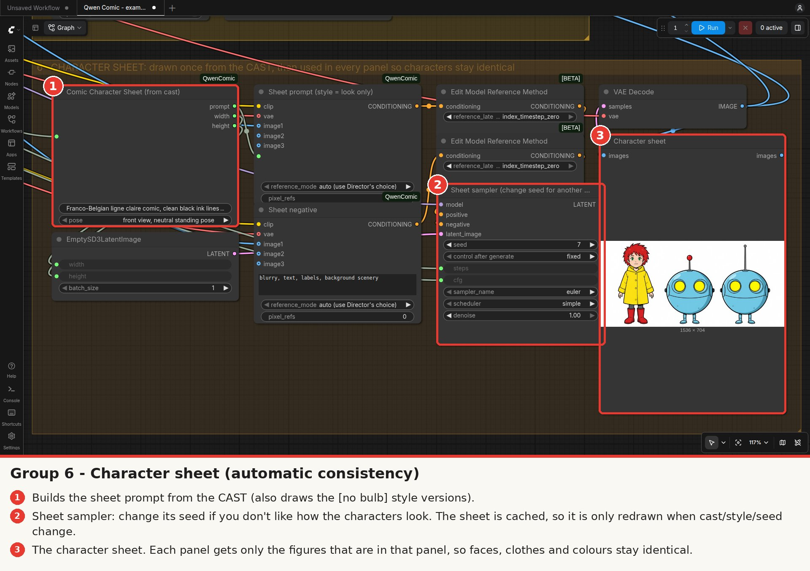

The sheet is drawn once from the CAST and cached, so it's only redrawn when the cast, the style or its seed changes. If you don't like how the characters look, change the seed of the *Sheet sampler*. Each panel gets only the figures of the characters that are in it, which keeps others from leaking in. To use your own drawing instead, connect a *Load Image* to the Director's `character_ref` input. Put the figures side by side with white space between them.

### Advanced: place references and text exactly

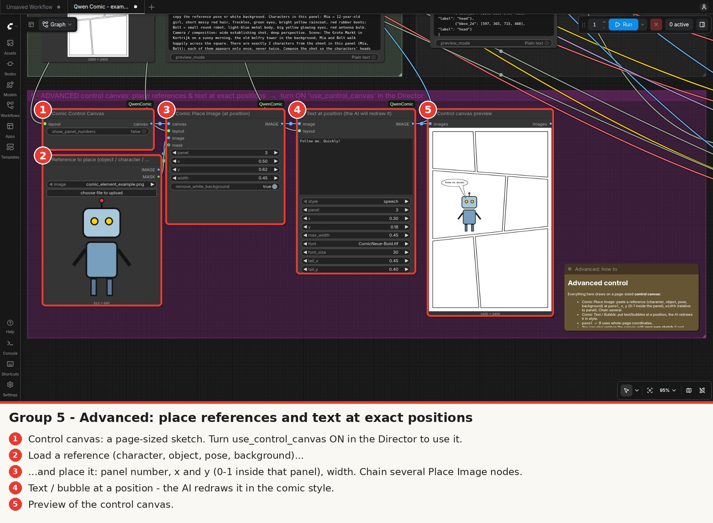

Turn `use_control_canvas` ON in the Director. Then:

- **Comic Place Image** pastes a reference (character, object, pose or background) at `panel`, `x`, `y` (0–1 inside that panel), with a `width`. You can chain as many as you like. For transparent PNGs, connect the MASK output; otherwise use `remove_white_background`.
- **Comic Text / Bubble** puts text at a position, and the AI redraws it in the comic's style.
- `panel = 0` uses coordinates on the whole page. You can also connect your own sketch to the Director's `control_canvas` input.

### Models and speed (group 1)

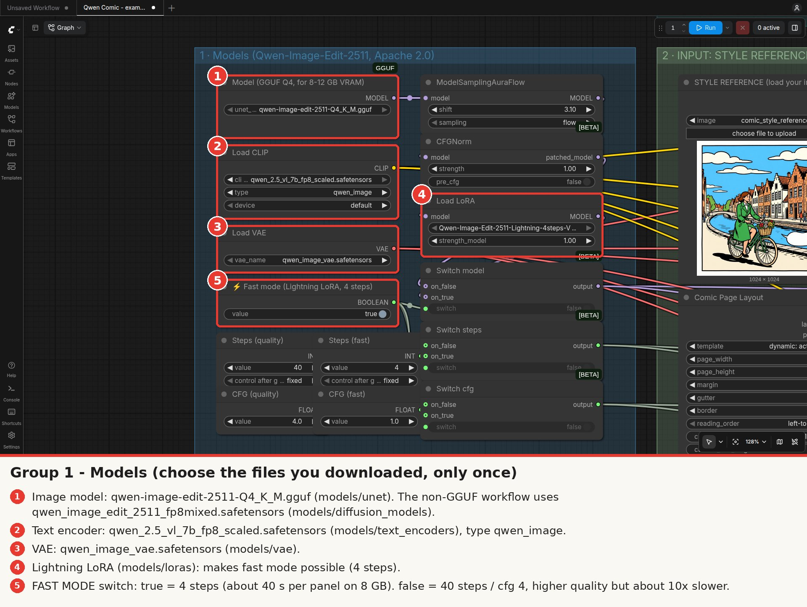

- **Fast mode ON** (the default): Lightning LoRA, 4 steps. On 8 GB VRAM, a panel takes about 40 seconds and a 6-panel page about 15–20 minutes, including the checks.
- **Fast mode OFF**: 40 steps and cfg 4. The quality is higher, but it's about 10 times slower. On 8 GB VRAM this can run out of memory.

### Vision check settings

- `check_panels` (in the Panel sampler): turns the vision check on or off. Without it, generation is faster, but duplicates are not caught and balloons are placed using only the character colours.
- `max_redraws`: how many extra attempts a bad panel gets (default 2).
- In the Qwen3.5 loader, choose **2B** (fast, the default) or **4B** (more accurate, much slower on 8 GB).
- The auto-fix needs the **Load CLIP** output connected to the Panel sampler's `clip` input. It is already connected in all included workflows.

## 8. Tips, speed and known limits

**Tips**

- Keep the seed fixed while you change the script. To get a new version of the page, change the **seed** in the Panel sampler.
- When two characters interact, describe clearly who does what. For example, "Mia screws the bulb onto Bolt's antenna" tends to work better than "Bolt screws it on himself", because Bolt has tiny hands.
- If a page has a problem, read the **Vision check report** and the **Balloon list** first: they tell you what happened.

**Known limits**

- The 2B vision model is fast but not perfect. In a busy crowd it can occasionally miss a duplicate.
- When a panel has very little empty space, a balloon may use smaller text or stick out over the panel border into the gutter. Use `adjust` to place it differently.
- Unusual poses can sometimes give odd anatomy, for example a floating head. Change the seed or rewrite that panel.
- At most 3 images can be used as references for each panel: the control canvas, the style and the character sheet.

**Troubleshooting**

| Problem | Fix |
|---|---|
| Red nodes or "missing node type" | Restart ComfyUI after copying the custom nodes. For the GGUF workflow, ComfyUI-GGUF must be installed. |
| "Value not in list" on a model loader | The file is missing or in the wrong folder. Check section 2, then press **R**. |
| Out of memory | Use the GGUF workflow with fast mode ON, or close other programs that use the GPU. |
| `vision check skipped: no vision model connected` | Download `qwen3.5_2b_bf16.safetensors` and select it in the Qwen3.5 loader. |

**Licenses:** Qwen-Image-Edit-2511, Qwen2.5-VL and Qwen3.5 are Apache 2.0. The Lightning LoRA is Apache 2.0. The fonts are SIL OFL.
